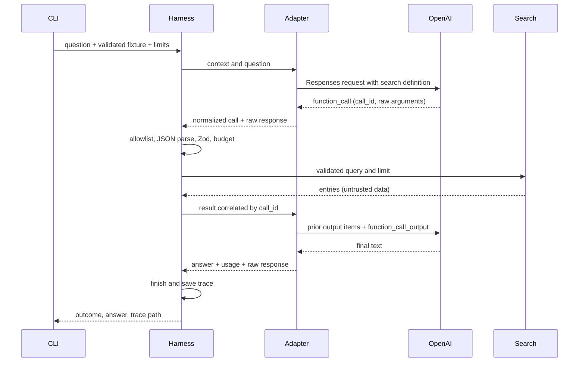

# Architecture

JFT keeps the harness explicit so two engineers can follow each decision. `cli-options.ts` uses Commander for parsing, required arguments, help and integer option validation. `config.ts` validates model credentials and defaults. `cli.ts` loads configuration, loads the fixture, supplies cancellation, and prints either a final answer or a failed-run message. `fixture-validation.ts` validates calendar dates, unique IDs and text with Zod and explicit character checks. `entries.ts` loads the file and hashes its original bytes. `context.ts` holds the versioned instructions and a small date-range context; journal content enters model context only through tool results. The latest fixture date anchors relative-date questions, making historical fixture runs reproducible.

`limits.ts` validates programmatic execution budgets. `validation.ts` checks tool names, identifiers, arguments and response completion separately from execution. `tool-execution.ts` executes validated search calls and records their results. `timeout.ts` isolates deadline and cancellation handling. `harness.ts` owns orchestration and a logical user/assistant/tool transcript. Its narrow `ModelAdapter` interface permits a scripted fake for tests; it is not a universal provider framework. `provider.ts` owns the official OpenAI SDK and maps output function calls to `{id, name, arguments}` while retaining provider-specific output items. `tools/search-entries.ts` owns search arguments, the generated JSON Schema and deterministic search. `trace.ts` handles trace construction and file persistence without driving execution.

## One tool interaction

## Continuation and termination

Each run creates one adapter. It sends `store: false`, requests encrypted reasoning content for stateless continuation, and replays local history, including complete reasoning items, assistant messages and function calls, then matching `function_call_output` items. This avoids assuming text-only role messages capture Responses API state. Unsupported output types fail explicitly. Instructions are supplied on every request. Raw provider responses in ordered events preserve inspectable continuation evidence; the harness transcript is a simpler logical view.

All calls in a response are considered before accepting final text. If calls and text coexist, text is recorded but not treated as final. Calls execute sequentially in output order. Only `search_entries` is allowed, and its JSON arguments must pass the same Zod schema used to generate the advertised tool schema. API strict mode is off to permit an omitted default limit; local validation is always enforced. Unknown fields, malformed JSON, invalid limits and unknown tools produce correlated error outputs for the next model turn. No dynamic tool lookup, shell execution or automatic tool retry exists.

Rejected requests consume budget. On budget exhaustion the loop stops without making another provider request, so unprocessed calls need no continuation outputs. A tool execution exception or timeout records a structured tool failure and terminates rather than continuing a partially processed batch. Termination distinguishes `completed`, `model_limit`, `tool_limit`, `timeout`, `provider_error` and `internal_error`. Empty and incomplete provider responses fail; no misleading successful partial answer is returned.

Per-operation timers race work and pass cancellation signals. Overall remaining time caps each operation. Timers and listeners are cleaned up. SDK retries are zero and there are no harness retries. Cancellation cannot forcibly interrupt synchronous JavaScript; fixture size limits or worker isolation would be needed for untrusted large datasets. Missing configuration and invalid fixtures are preflight errors, outside attempted harness runs.

## Tracing and evidence

Every begun run collects timestamped typed events in order, including requests, responses, raw calls, validation, tool results, durations and errors. The final trace adds outcome, answer if available and total duration. It contains prompt version, context, fixture bytes hash and parsed data for reproduction. Persistence is attempted once at termination; if it fails, the CLI fails and reports the disk/permissions issue. Hard process termination cannot guarantee a trace. Failed provider requests record the logical request and error rather than fabricating a response or usage.

Journal entries are untrusted strings inside tool result objects. Instructions explicitly separate them from authority. Deterministic tests verify the dispatch boundary even when scripted model output requests an unauthorized tool after seeing malicious content. This proves the allowlist, not model-level injection resistance or factual accuracy. A live model can still misinterpret text, omit contrary evidence or invent citations.

## Tradeoffs

Search tokenization uses `Intl.Segmenter('en')` word boundaries without regular expressions. Exact keyword search is readable, cheap, stable and testable without external services. It has weak recall for synonyms and morphology, cannot infer semantic relationships, and relies on the model for date interpretation. Stable fixture-order ties make failures reproducible. No full-fixture context experiment is implemented yet.

There are no agents, planners, parallel tools, generic plugin registry, embeddings, vector stores, database, frontend, audio, authentication, deployment or evaluation infrastructure. Prompt changes are a versioned constant rather than a management system. Real journal use requires a separate privacy and retention design; full content traces are acceptable here only because all data is fictional.

The orchestration code separates requesting a model turn, executing a sequential tool batch, advancing the loop, classifying failures, and finishing the trace. The loop itself carries only pending results and execution budgets.
